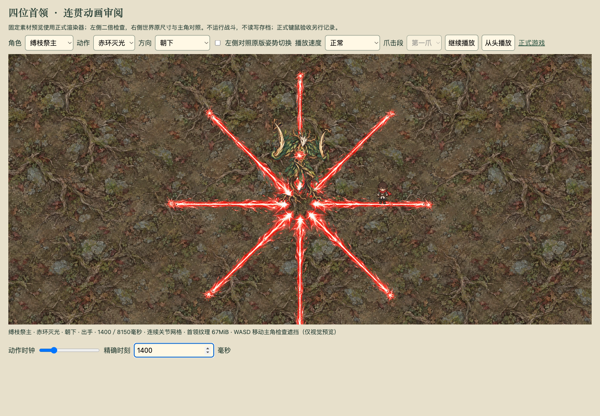
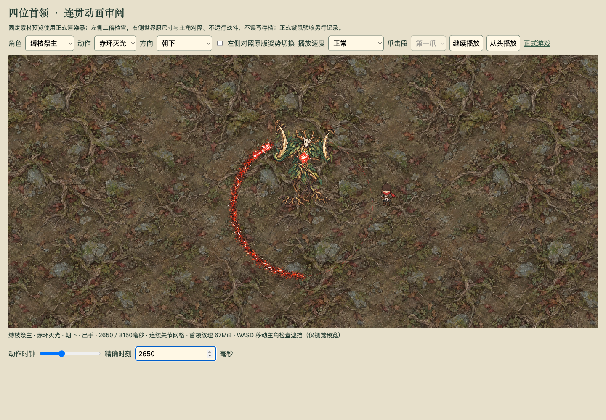
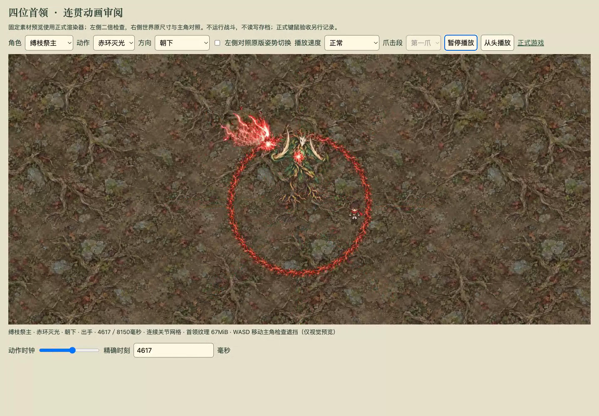

# 赤环灭光：第二版特效与验收边界

此文件保留第二版历史记录；用户随后否决了第二段爆裂的静态贴图表现，当前实现与证据见[第三版定点逐帧爆裂](LASER-VFX-V3.md)。

2026年10月4日。用户指出第一版只有几条加粗红线，未达到批准设计的美术效果。第一版美术验收不通过；本轮按原设计重做，保持既有招式时序、几何、伤害和保存协议。

## 实际交付

- 八向激光：透明白热内芯、参差红色光丝、两端爆闪、相对战斗时钟驱动的流动亮点。
- 圆周扫射：一个能量头部沿圆周推进，身后留下不规则焦裂地痕与熔炽裂缝，未扫部分仅显示预告虚线。
- 第二段：三个错峰短爆裂、升起的火焰刃、飞石与火花沿原圆周推进；不会整圈同时爆炸。
- 收招：已烧出的地痕连续淡出，正式伤害危险区仍按原时刻清除。
- 地面特效低于角色；胸核使用首领上层。预览替换为正式东门巢穴地面，支持真实键盘移动主角检查可见性。

以下均为正式渲染器实际结果，不是概念图，也不是完整正式战斗验收。

[连续播放片段](evidence/laser/preview-v2-loop.mp4)为第二版实际连续播放实录，仅截取播放过程并转码，没有合成特效帧。第二段历史截图从该实录中提取，避免与第三版混用。

## 素材来源与生成输入

使用 imagegen 技能的内置图片生成工具，参考[已批准设计](design/east-boss-laser-v1.png)，透明背景生成四种独立特效。素材为[透明图集](../../public/assets/boss-laser/laser-vfx-v2.png)，1536×1024，带真实透明通道；约6 MiB解码像素。保留原始像素，以代码登记矩形帧，没有手动涂改特效。

文件摘要：`688916582591679430c068115cb090c8887680578945f63ff43ddf65c423469d`。

实际生成提示词：

> 以参考图的红色能量特效为美术标准，制作可直接用于俯视角 Phaser 游戏的透明背景特效图集。只输出特效素材，没有角色、场景、文字、格线或标注。画布分成严格相等的 2×2 四个正方形区域，各素材完全位于自己的区域内，四周保留透明间距。左上：水平朝右的狭长红色激光束，细而极亮的白热内芯，尖锐不规则轮廓，层叠的猩红辉光、流动电弧光丝和少量飞散火花；不要画成粗直线。右上：红白激光碰撞爆闪，白热小核心、尖锐星芒、参差电弧、红色光晕和火花，中心明确。左下：沿地面向右推进的第二段激光爆裂，底部沿水平地面，向上升起白热红色火焰刃与细电弧，明显飞起的深色碎石，强烈能量头部在右侧，短尾迹在左侧；必须显得立体、猛烈、贴地推进。右下：水平焦黑地裂灼痕，参差焦黑岩土裂口、细亮红色熔炽裂缝和零星余烬，不是光束。整体采用参考图精致的手绘游戏特效风格，颜色明亮、层次丰富，真正透明背景，不要黑色底，不要白色底，不要棋盘格。四个素材之间绝无交叠。

实际生成结果为宽画布、素材位置不是等分正方形，因此登记了经过截图检查的矩形帧坐标。图集只预加载一次；对象池按需复用，上限64，当前八向配置实际峰值45。每帧重画前隐藏旧素材；场景关闭由 Phaser 销毁对象，没有新增定时器、存档字段或额外攻击状态。

## 证据

- 四个专项文件共48项通过：激光机制、双臂网格、旧首领表现与新素材生命周期。新测试检查反复播放对象复用、停止后隐藏、暂停与相对时钟读档一致、阶段切换不残留光束。
- 浏览器专项1项通过：六阶段固定画面、一整套连续播放、真实按住 A/S 移动主角、暂停一致、旧树镰和狼爪切换。页面无运行异常；[记录](evidence/laser/preview-validation.json)包含实际主角位移和全部连续采样。
- 类型检查与生产构建通过，当前构建入口 `game-VNMZ82Tu.js`。Chrome 正常开发页也已实际打开并检查第二段画面。

## 对抗审查

VERDICT: PASS

P0/P1 BLOCKERS: 无。

审查素材矩形范围、透明通道、正式预加载链、地面与角色深度、移动能量头部与危险区方向、障碍截断、恢复时钟、取消及死亡后的可见性、对象池上限与场景资源销毁。素材只读取正式轨迹与相对时钟；收招灼痕为视觉层，未延长正式伤害。暂停和时钟恢复由专项反证验证；所有对象由场景持有，场景关闭会销毁。未发现有合理可达路径及严重影响证据的 P0/P1。

UNVERIFIED RISKS: 最终主观美术与设计图的完整一致性待用户验收；完整正式首领战、原存档施法中保存重开、跨设备帧率与长期性能本轮未验收。真实键盘移动发生在正式渲染器预览场景，不冒充正式首领路线通过。新素材仍按临时美术验收状态记录。

NON-BLOCKING FINDINGS: 首领保留既有树身与关节网格造型，未替换为概念图的更粗壮树身；火焰刃采用素材错峰缩放与火花抛物线动画，尚非独立逐帧火焰序列。这些差异不阻塞代码审查，也不能据此宣称最终美术通过。
