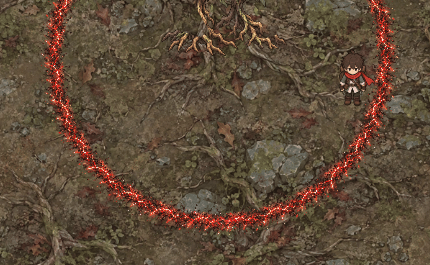
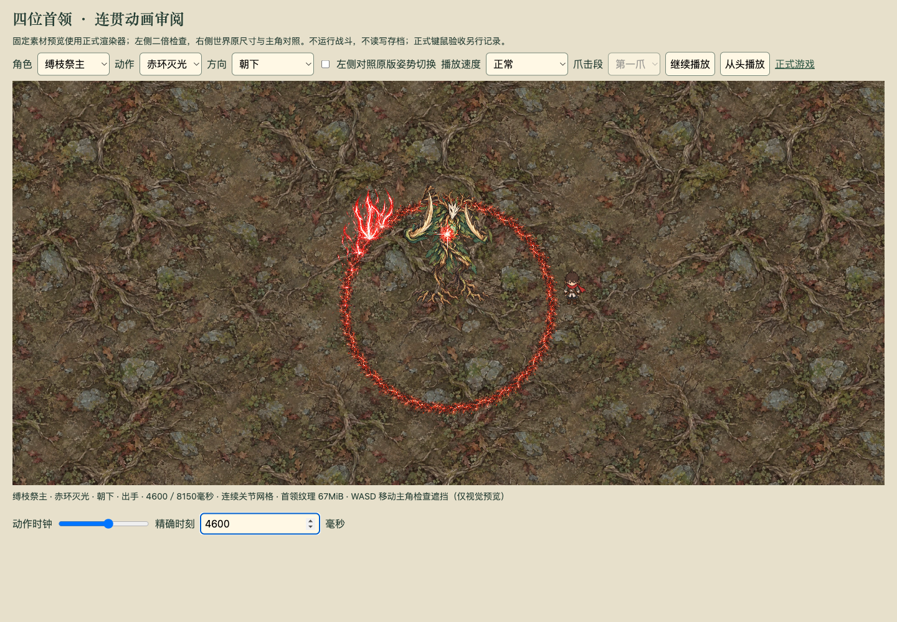

# 赤环灭光：第三版定点逐帧爆裂

2026年10月4日。用户否决第二版的第二段效果：爆裂只是同一张贴图缩放后沿圆周移动，没有火焰自身的展开和消散。第三版已删除该绘制路径，第一段射线与刻线仍沿用已接入的素材。

## 动画行为

原灼痕圆周分成36个固定落点，在第二段1450毫秒内依次触发。每个落点独立播放12种火焰形态，330毫秒内完成地裂亮缝、喷薄、分叉、断裂、余烬和消散。火焰贴图的世界坐标、旋转和显示尺寸在该落点的整个生命周期保持固定；增长和断裂来自实际换帧，不来自整张图移动、旋转或周期缩放。

火焰根部按原素材三行实测坐标对齐到同一地面落点。每处四块飞石和三道火星独立采样横向速度、重力、自转和440毫秒生命周期；不会作为火焰图片的组成部分绕圈运动。地面冲闪与短震圈也读取各落点的年龄。

火焰峰值发生在落点激活后约60毫秒，对应既有短尾危险区经过的时间段。随后碎光与飞石仅是余效；正式伤害时序、宽度、去重、预警和保存协议均未修改。收招期间最后几处余效可完成消散，不延长正式伤害。

所有阶段使用相对模拟时钟，没有新计时器、异步播放回调或持久化字段。取消、死亡或撤战后的下一帧隐藏整个对象池。贴图由场景管理并在场景关闭时销毁；池上限64，实际八向配置本轮连续播放峰值43。

## 实际播放证据

[正常速度完整招式](evidence/laser/preview-v3-loop.mp4)、[四分之一速爆裂片段](evidence/laser/preview-v3-quarter.mp4)、[完整浏览器实录](evidence/laser/preview-v3.webm)。局部动图来自运行中的清晰局部截图连续采样，按记录的模拟时钟间隔还原四分之一速，避免浏览器录像压缩丢失火焰细节；没有合成火焰帧。慢放来自正常预览速度控件。

## 验证结果

- 四个专项文件49项通过：既有首领、激光机制、关节网格、对象复用、停止后隐藏、相对时钟恢复及定点火焰生命周期。
- 浏览器专项1项通过：六阶段、固定首个落点的12帧、完整正常播放、真实键盘移动主角、暂停稳定与旧树镰／狼爪切换。
- 四分之一速真实播放期间实际采到帧0至11全部12帧，首个落点始终为世界坐标（700，790）。这项检查来自运行中的自然换帧，未调用渲染器接口改状态。详见[观测记录](evidence/laser/preview-v3-validation.json)。
- 类型检查与生产构建通过，入口为 `game-DfRRCXr3.js`。Chrome 当前开发页也已实际检查固定落点起爆画面。

检查途中发现预览时钟输入冲突：运行中的每帧绘制会回写精确时刻输入框，干扰正在输入的文字，导致900毫秒被误解释并截断到8149毫秒。首因轨迹与录像保留在本地验证目录；修正为输入框获得焦点时停止自动回写，之后完整专项通过。没有以重跑掩盖该失败。

## 素材与生成输入

通过 imagegen 技能的内置图片生成模式制作透明逐帧素材；[原第二版图集](../../public/assets/boss-laser/laser-vfx-v2.png)仅为风格参考。新素材为[第三版爆裂图集](../../public/assets/boss-laser/laser-burst-v3.png)，1448×1086，4列×3行，每格362×362，带真实透明通道。保留原像素，以代码登记帧和实测地面根，未涂改素材。

文件摘要：`07d0acb1aab6519a7c4429bed51d49f274dacc3b060faa65cdee180e46712d44`。

实际生成提示词：

> 制作一张游戏逐帧动画精灵图集，真正透明背景。参考图仅用于红白电弧的手绘美术风格。必须是同一个固定地面落点发生的一次红色等离子爆裂的连续12帧，不是12个类似爆炸图案，不是旋转或缩放同一张图。严格4列×3行等大的单元格，按从左到右、从上到下的顺序。每帧同一相机、同一大小、同一水平地面高度，底部落点都在单元格宽度50%、高度88%；无文字、无数字、无网格、无边框、无背景、无黑底、无场景和角色。每帧留足透明边距，素材不能跨单元格。连续演变：第1帧是地面极细的红白裂缝；第2帧裂缝闪白、能量芽出现；第3帧火舌从裂缝向上喷出，只有最大高度四分之一；第4帧形成一半高度的两条弯曲火焰刃；第5帧升到四分之三高度，火焰分叉；第6帧达到爆裂峰值，五条白热内芯、猩红外缘的弯曲尖锐等离子火焰刃向上喷薄，参差能量光丝；第7帧火焰外卷，尖端断裂飞出；第8帧火焰根部开始断开，上部碎光继续升起；第9帧只剩三条稀疏断裂的细能量流和碎光；第10帧仅剩向上散开的红色小余烬；第11帧只剩很少几个暗红余烬；第12帧几乎完全消散，只剩地面一点极暗余火。总动画视觉感受为突发、向上爆发、分裂、升腾和消散，不要静止的长尾激光箭头。不要画大块岩石、烟雾圆团或整片红色底光，飞石另由游戏动画生成。精致手绘风格，尖锐参差的火焰形状和细碎火花，强烈的白热红光，不要简单卡通三角形。

## 对抗审查

VERDICT: PASS

P0/P1 BLOCKERS: 无。

审查固定落点与正式圆周轨迹、火焰峰值与危险区时序、帧边界及地面根、年龄边界、恢复时钟、收招余效、中断清理、场景资源和对象上限。固定落点和十二帧自然播放由浏览器采样反证验证；暂停及相对时钟恢复由确定性专项验证。没有发现具有合理可达触发路径与严重影响证据的 P0/P1 问题。

UNVERIFIED RISKS: 最终主观美术仍待用户验收；完整正式首领战、原存档施法中保存重开、跨设备帧率与长时性能本轮未验收。真实键盘移动在正式渲染器预览场景进行，不代表正式旅途验收。

NON-BLOCKING FINDINGS: 火焰为12帧手绘序列，碎石与火星为独立连续采样；首领树身仍沿用既有图集。生成素材的地面根以实测三行坐标修正，最终美术验收标记仍保留为临时。
