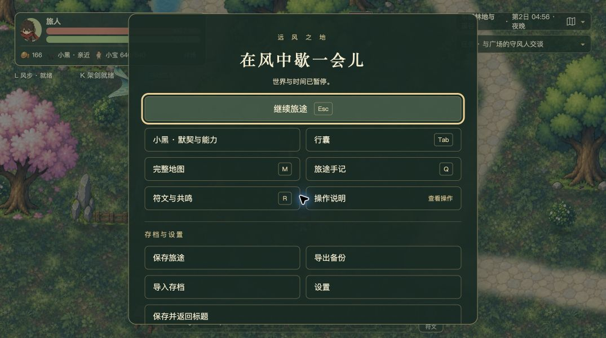

# 刷怪、多重预警与风步后持续掉帧：根因复核

日期：2026年10月4日。用户确认网址为 `http://127.0.0.1:5309`，不按 I 也掉帧。本轮完成逐帧诊断和修复构建的本地交付，没有新增正式游戏逻辑修改、提交、推送或公开部署。

## 结论及当前状态

本次现象包含两个已测到的性能问题，以及一个上轮交付遗漏：

1. **用户原5309页面仍运行修复前代码。** 上轮源码和独立端口的固定构建对照确实改善性能，但没有更新用户正在玩的5309。不能把源码修复完成等同于用户页面已经修复。
2. **持续掉帧的主要开销是攻击接触预测反复完整推演。** 它同时来自每画面帧的预警，以及每个约5毫秒战斗子步的小宝威胁环境；后者在旧版慢帧中占主要部分。风步拉远后，旧预测缺少距离上界排除，仍推演到攻击有效期结束。不需要 I 键或剑风参与。
3. **还有独立的地形短抖动。** 镜头移动时，地面块在渲染前同步烘焙和创建纹理。每帧最多预取一块，但一块仍耗时约8～14毫秒，超过120赫兹屏幕约8.33毫秒的整帧预算。攻击预测修复没有处理它。

5309现已更新到上轮经过专项及构建验证的修复包，正常保存、刷新、继续旅途后，位置、生命、金币、行囊、风赐、主线、存档版本与遭遇进度逐项一致。页面停在暂停菜单。**持续预测开销有修复及对照证据；地形短抖动已定位、尚未修复，不能宣布所有掉帧彻底解决。**

## 一、为什么上轮之后用户仍能复现

原页面DOM实际加载 `assets/game-Ce3jbXWA.js`。本机5309旧发布目录与冻结的修复前构建中，此文件均为789841字节，SHA-256一致：

`938d897f5fe78ffd2d30cc2a0f0955a02b167e6b708a496a617d6006a1aca701`

检查时5309已无服务监听，但浏览器内存里的旧游戏还在运行。修改源码、构建新目录或在另一个端口验收，都不会替换已经载入的旧脚本。上述证据来自[页面更新前记录](page-before.json)与[构建校验](loaded-build.json)。

本轮启动5309本地服务，指向 `.combat-performance-local/fixed-production/`。随后通过正常“保存旅途”确认存储事务成功，再刷新原页面并继续旅途。现加载 `assets/game-B-oSh5Qt.js`，SHA-256：

`185c43927a3eebbef828e773296037dc37696af7bd56986821b50821d93f14a7`

这是上轮验证过的固定构建，未把当前工作树并行开发的首领激光等修改混入交付。它也不含本轮诊断控件。相关证据：[保存成功提示](save-confirmation.json)、[更新后页面及回读](page-after.json)、[逐项核对与包校验](delivery-check.json)。最新原始存档备份保存在 `/Users/archer/Downloads/farwind-save (20).json`。

## 二、沿用户的完整过程解释

### 地上出现圆圈、怪物出生

出生提示由 `encounterRuntime.ts` 的统一到达队列管理，提前900毫秒提示，出生后260毫秒移除。`enemySpawnView.ts` 复用绘图对象并逐帧清理，没有为每个圈建立一个无限持续的计时器。

本次最慢的攻击窗口，出生圈绘制平均仅约0.004毫秒／帧；遭遇更新平均约0.234毫秒／帧。出生让多只怪物随后同时进入攻击状态，是后续计算量增大的前提，但这些数据不支持把持续数秒掉帧归因于“圆圈越积越多”。单次实体创建成本不因此被认定为零。

### 多个攻击指示器出现

有两条同时运行的接触预测入口：

```text
画面每帧：World.drawWarnings
  ├─ predictEnemyContact：何时会碰到玩家
  └─ EnemyView.warn → previewWarning：推演地面危险区

战斗每个约5毫秒子步：World.advanceBattle
  └─ xiaobaoEnvironment
      └─ 遍历有效攻击，为其目标计算 threatAt
          └─ predictEnemyContact
```

具体位置是 `World.ts:1579`、`World.ts:1815` 与 `xiaobaoWorld.ts:78`。小宝的环境参数在调用 `controller.tick` 前就已求值。**即使小宝安排为自由行动、位置仍在长者家，环境中的威胁预测也已经执行。** 用户最新存档正是这种状态。

旧 `predictEnemyContact` 会复制攻击状态，调用 `advanceEnemyAttack` 推进到 `activeUntil`：移动按最多5毫秒一段推演，接触按1毫秒粒度扫描，移动与障碍路径又调用 `solidPropAt`、`propLineBlocker` 等查询。旧查询反复扫描全地图实体，而不是只看攻击附近。

第19份存档的4～6秒慢窗口，旧版每帧平均调用接触预测9.34次；仅预测内部就有约293次障碍线查询及188次实体点查询。查询次数与每次全图扫描叠加，才是主要CPU成本；不能只看屏幕上画了几个圈。

### 风步拉远，为什么仍持续慢

拉远玩家不会立即取消怪物已经承诺的攻击。旧版又没有先判断“剩余最大位移加攻击几何是否绝对够不到目标”，所以会重复完整推演，最后才得出没有接触。

更关键的是时间轴的放大：`timeline.ts` 以5毫秒量级子步推进，每画面帧最多处理50毫秒模拟预算。画面变慢之后，一帧需要推进更多子步；每个子步又重新构建小宝环境、重新预测，进一步增加该帧成本。样本中旧版慢窗口平均5.33次战斗推进／帧，修复版2.78次。边界和输入可额外切分子步，因此不能直接用帧间隔除以5当作准确调用次数。

这是**有50毫秒上限的计算开销放大**，不是无限循环或无限积压。样本的掉帧在风步前的密集攻击阶段就已开始，风步并非唯一触发器。

### 为什么过一会儿又恢复

攻击命中、已结算、取消或越过有效期后，预测入口直接返回；收招结束则清除攻击对象。重叠的高成本预测暂时减少，帧率随之恢复。下一批攻击开始时可以再次变慢。

第19份存档旧版4～6秒约47.8帧／秒，6～9秒恢复约119.7帧／秒，**这两个窗口生命值始终100**；11～13秒下一轮攻击又降到约67.5帧／秒。这提供了“未死亡、未回村也会掉帧后恢复”的完整证据。

## 三、不按 I 的旧版与修复版对照

均在本机Chrome生产构建运行，使用正式导出的第19、20份存档副本。诊断按钮模拟方向、风步与跑步按键，走正式输入链路；不授予技能、不调整怪物或生命。四轮剑风数峰值均为0，失焦帧均为0。

| 同一路线的统计窗口 | 旧预测与查询 | 修复预测与查询 |
| --- | ---: | ---: |
| 第19份存档：4～6秒，多预警与风步 | 47.80帧／秒 | 117.57帧／秒 |
| 第19份存档：6～9秒，存活时恢复 | 119.66帧／秒 | 119.95帧／秒 |
| 第19份存档：11～13秒，后续攻击 | 67.51帧／秒 | 115.40帧／秒 |
| 第19份存档：排除冷启动及重生后的平均 | 96.88帧／秒 | 118.21帧／秒 |
| 第20份存档：排除冷启动及重生后的平均 | 62.96帧／秒 | 116.84帧／秒 |

第19份存档4～6秒窗口的分项如下。计时存在父子调用包含关系，**接触预测、小宝环境、战斗推进不能相加**。

| 每画面帧的平均CPU时间 | 旧版 | 修复版 |
| --- | ---: | ---: |
| 全部接触预测 | 8.556毫秒 | 0.037毫秒 |
| 小宝环境构建，包含其中的接触预测 | 7.323毫秒 | 0.044毫秒 |

旧版同窗口战斗推进总计平均12.507毫秒，整个预警过程2.017毫秒；寻路批次0.041毫秒、只读观察输出0.019毫秒。这些数据把主因指向共享预测与碰撞查询，不支持将本样本持续掉帧主要归因于寻路、出生圈、I键特效或诊断文字输出。

上轮两个修复正好覆盖共同入口：共享128单位网格先筛候选，再做原精确障碍判定；普通近战先用保守的可达上界排除远目标，范围内、首领和特殊攻击保留原精确路径。它同时改善预警和小宝威胁分析，无需关闭指示器、伙伴功能或降低伤害判定精度。

## 四、修复后仍存在的地形短抖动

`terrain.ts:210` 的地形刷新绑定场景 `prerender`。镜头越过地块边界时，它同步创建600×550画布，绘制草地、道路、羽化遮罩与地面装饰，然后刷新纹理。非可见区域限制“每帧一块”，可见缺块则当帧补齐；离开保留圈的块立即销毁。

第20份存档的新旧两轮都在撤离途中生成同一排5个地块。修复版在约5.389～5.445秒连续五帧生成：

| 地块 | 地形刷新／烘焙耗时 | 整帧CPU耗时 |
| --- | ---: | ---: |
| ground-2690-3020 | 8.6毫秒 | 12.0毫秒 |
| ground-2090-3020 | 12.0毫秒 | 15.4毫秒 |
| ground-3290-3020 | 7.8毫秒 | 10.8毫秒 |
| ground-1490-3020 | 12.1毫秒 | 15.2毫秒 |
| ground-3890-3020 | 10.2毫秒 | 13.8毫秒 |

这些帧的生命值均为66.34，发生在风步撤离阶段，非死亡回村。旧版对应的地形时间为8.1～14.0毫秒，叠加旧战斗计算后整帧为17.2～23.8毫秒。

因此，“每帧只做一个块”并未保证时间预算。玩家风步带动镜头移动，预取队列即使在角色停下之后也可能继续处理几帧。这可以解释持续预测掉帧之外的短暂连续抖动，不能把两者混成同一个根因。

每个上述地块帧观察到两次 `texImage2D` 调用，与Phaser `createCanvas` 的初始纹理创建、绘制完成后的 `refresh` 路径一致。计时覆盖主线程Canvas工作及纹理提交；**没有GPU硬件时间或GC暂停的直接采样，不能断言全部时间都是GPU上传或垃圾回收。**

地形修复应独立处理：优先分解单块烘焙成本，对羽化计算与装饰做相交区域裁剪或静态预烘焙；需要增量生成时把大任务切成可受毫秒预算约束的小任务，并在进入视野前完成、成块发布。单纯在完整 `drawTile` 外面加时间检查无法中断已经耗时12毫秒的一块。若保留离屏缓存，必须有容量上限及清剿状态失效规则，避免缓存陈旧地面或无限增长。以上尚未实施和验收。

## 五、证据边界与复核办法

- 本轮固定诊断构建对照仅替换冻结的四个性能相关模块，其他模块使用采样时工作树；它不是修复前整个发布包的逐字节重放。期间工作树已有独立的首领激光改动，第19、20份存档的样本为普通遭遇，不覆盖首领新增逻辑。
- 相同存档、相同输入流程，但未冻结随机数与逐帧时刻。等待多重攻击的实际时刻略有差异，伤害和死亡时刻也不完全相同。表格用于复现趋势及定位热点，不是逐帧因果干预实验。
- 长样本后段确实死亡回村。原始记录保留；主要平均值排除头1秒载入与重生后的全部帧，恢复结论只采用生命值保持100的6～9秒窗口。识别重生使用本样本坐标跳变及生命恢复交叉确认，不能把该脚本当通用传送检测器。
- 第19份记录未加入地形单独计时，摘要显示空值，不能读作地形成本为零。第20份两轮才加入该计时及新增纹理名。
- 预热加载中的地形集中生成、死亡回村的地形集中生成单独识别，未拿这些长帧冒充“每波刷怪必然卡顿”。
- 初次探索记录 `old-save19-retreat-initial.json` 曾有流式UTF-8拼接瑕疵，保留原件，不用于正式比较；后续保存端按字节拼接后统一解码，四份正式记录已核对。
- 两版使用相同计时方式，但调用数量不同，探针开销不一定相同；表中数值属于插桩测量，不能当作无探针版本的绝对帧率保证。渲染时间为CPU提交；未做直接GPU分析、内存堆快照或长期跨设备耐久测试。样本中未发现的成本不能据此被完全排除。

运行 `python3 docs/performance/combat-stall-20261004/analyze.py` 可从四份原始文件重建[对照摘要](comparison.json)。[诊断构建脚本](build-trace.mjs)与[逐帧记录控件](trace.js)可在本工作区重建诊断入口；它们依赖本机冻结源码及下载目录中的两份存档，不是可移植基准。诊断服务使用5314／5315，用户页使用5309，用户原始存档没有被测试过程覆盖。

本轮未更改正式游戏代码，未重跑全量测试。上轮150项战斗专项、构建通过及既有全量失败的范围见[原修复报告](../combat-warning-wind-20261004/report.md)，不得将其外推为当前全部并行工作树已通过验收。

## 六、本轮增量审查

VERDICT: PASS

审查对象仅为本轮诊断脚本、证据解释和5309本地交付；不代表现存所有性能问题已解决或整个工作树允许发布。

P0/P1 BLOCKERS:

无。已反证检查数据被诊断修改、存档被测试覆盖、将后台或重生误判为性能恢复、诊断脚本进入正式包以及嵌套计时重复相加等风险。独立端口、零剑风／零失焦记录、存活窗口、更新前后读档逐项对照与正式入口核对支持本轮边界。

UNVERIFIED RISKS:

- 地形短抖动尚未修复，其他构筑、首领、设备及长时间游玩仍可能有独立热点。
- 当前工作树并行首领改动没有随此次固定构建交付，也没有在本轮接受完整审查。

NON-BLOCKING FINDINGS:

- 后续修复地形后，应复用第20份存档同一路线，逐帧核对地形耗时、画面完整性、缓存容量和清剿后的外观更新；只看平均帧率不足以验收。
- 小宝威胁环境的子步调用仍存在，但修复后本样本仅约0.044毫秒／帧。直接用“是否同行”屏蔽它可能影响飞援和应急保护语义，未证明必要性前不做该改动。


