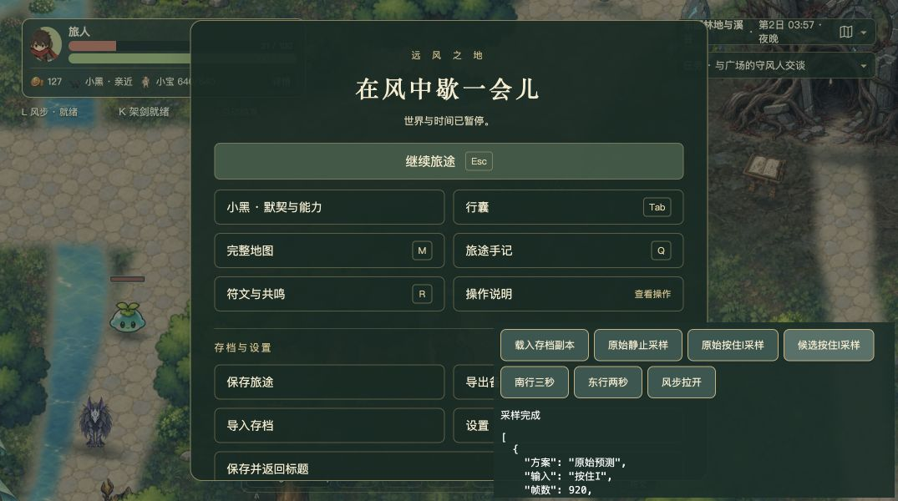

# 攻击预警、风步与持续剑风掉帧调研

调研日期：2026年10月3日。当前状态：已定位并验证主要瓶颈，已验证隔离候选方案；未修改正式游戏源码，未提交或推送。

## 结论

主要开销来自 CPU 侧碰撞查询。预警每个渲染帧都会重新推演攻击；攻击推进与特殊攻击也共用碰撞查询，现有查询反复遍历全地图物件。风步离开攻击范围后，代码仍完整扫描已经不可能命中的攻击。在持续剑风期间，这些工作与正式战斗时间轴推进叠加，造成较长的帧间隔。

当前地图有681个物件，其中590个有碰撞。Chrome隔离实战对照中，空间索引与保守范围排除显著降低战斗推进、结算与预警耗时；剑风表现、渲染提交耗时基本没有相应变化。因此本次样本支持共享碰撞查询是主要原因，不能据此断言所有其他掉帧都来自同一原因。

## 调用链与证据

1. `World.ts:1815` 的 `drawWarnings()` 每帧遍历攻击来源，调用 `predictEnemyContact()`。
2. `enemyAttack.ts:104` 复制攻击，推进至 `activeUntil`。`advanceEnemyAttack()` 每5毫秒推进移动，并按1毫秒寻找接触，使用原地形、实体障碍和视线判断。
3. `attackWarningView.ts:22` 的 `previewWarning()` 为绘制危险区，再推进一次攻击副本。虽然关闭命中扫描，移动扫描和障碍查询仍存在。
4. `obstacles.ts:41` 的 `propLineBlocker()` 对全体物件调用矩形裁剪；`world.ts:898` 的 `solidPropAt()` 对全体物件做点查询。一次预测要多次调用这些函数。
5. `timeline.ts` 以5毫秒粒度推进正式战斗。`advanceBattle()`、`resolveBattle()`、伙伴威胁预测和剑风飞行也会查询同一组障碍；长帧需要推进更多子步，增加后续帧的工作量。
6. 寻风瞄准镜在攻击开始时查询合法目标，`firstSwordWindBlocker()` 同样遍历所有物件；空间筛选也能覆盖这个入口。

史莱姆的固定范围外预测，每只仍执行40次点查询、60次运动线查询；狼为72次点查询、108次运动线查询。范围外本应能立即排除，但当前代码仍推演全部攻击段。

预警清理已有路径，活动敌对单位已有12名额限制。没有发现本次现象需要无限刷怪或对象无限增长才能触发。此前透明阴影占位填充修复已存在于当前源码，不能用此前的阴影根因代替本次诊断。

## Chrome运行对照

使用原生Chrome、当前工作树的独立Vite端口5311、正式导出的第19份存档副本。原5173与5309存档未被导入覆盖。

诊断控件经过游戏正常输入链路发送按键：同一存档起点向南走3秒，向北风步拉开，再按住I测8秒。怪物由正式遭遇系统自然生成，没有授予技能、传送或修改怪物生命。按键是诊断控件发送的模拟输入，不等同于用户原生键鼠验收。

运行结果见下表。分项时间存在嵌套，不能相加当作总耗时。

| 指标 | 原始逻辑 | 候选优化 | 恢复原始逻辑 |
|---|---:|---:|---:|
| 平均FPS | 103.38 | 120.02 | 103.38 |
| 帧间隔P95（毫秒） | 16.70 | 9.30 | 16.80 |
| 最长帧间隔（毫秒） | 33.40 | 9.40 | 25.80 |
| 战斗推进P95（毫秒） | 9.80 | 1.10 | 9.60 |
| 战斗结算P95（毫秒） | 2.20 | 0.40 | 2.10 |
| 预警P95（毫秒） | 2.30 | 0.20 | 2.40 |
| 剑风表现P95（毫秒） | 0.10 | 0.10 | 0.10 |
| 渲染提交P95（毫秒） | 1.40 | 1.20 | 1.30 |
| 预警与剑风共存帧 | 31 | 55 | 32 |

组合场景原始与候选的起点相差不到1个世界单位；战斗结束生命都为20.8。候选样本包含更多预警与剑风共存帧，因此不能把改善解释为关掉预警或减少怪物。全程未丢失焦点，也未进入后台。

本次没有锁定随机数与逐帧输入时刻，不是完全相同的录制回放。受击按正式规则清理持续剑风，所以组合共存帧数有限，不能外推成连续长时间施法验收。另一个同存档的无预警样本中，单独按住I平均约115FPS，剑风表现P95约0.2毫秒。

浏览器原始数据：[运行对照](browser-results.json)。早期探索记录：[初始测量](browser-initial.json)。

## 固定基准与等价性

基准使用项目实际障碍数据，由Node通过Vite加载源模块。十二只同种敌人是放大开销的固定专项，不能把它直接写成正式遭遇的FPS。源码哈希保存在结果文件中。

| 十二只怪的危险区路径预览 | 原始平均（毫秒） | 索引候选平均（毫秒） |
|---|---:|---:|
| 史莱姆 | 24.93 | 0.61 |
| 狼 | 42.17 | 0.85 |
| 林豕 | 41.60 | 0.87 |

保守范围排除将范围外十二只近战的接触预测降至约0.003毫秒；危险区仍正常绘制，路径预览依靠空间索引提速。

- 接触预测：1152例，其中451例可命中，候选与原精确扫描无差异。覆盖8种近战行为、不同距离与方向、锁向、已推进状态、受击延迟，以及项目地形和固定墙面。
- 空间查询：30000次点查询、运动线与近战线对照，结果无差异。
- 动态几何：216次开关门及解除／恢复传承封锁后的查询对照，结果无差异。
- 以上是已测试样本范围，不是对全部攻击与地图状态的穷尽证明。首领特殊几何不使用范围排除候选。

基准与结果：[可运行基准](benchmark.mjs)、[原始结果](benchmark-results.json)。运行命令：`node docs/performance/combat-warning-wind-20261003/benchmark.mjs`。

## 建议的正式修复

优先落地两项已验证优化，保持原伤害、攻击范围、预警样式、模拟步长和弹反时间精度。

1. **在共享物件查询中加入空间筛选。** 用128世界单位的网格登记固体物件；点或线段只取经过格子的候选，再调用原来的精确判定。运动查询扩张脚底半宽12、半高10，近战使用实体原边界，剑风按自身半宽扩张。候选保持原物件顺序，显式传入自定义物件数组的调用继续尊重该数组。
2. **在近战接触预测前加入保守范围排除。** 剩余最大前移距离加攻击几何包围半径，作为允许完整预测的上界。超过上界才返回无法命中；边界和范围内仍使用原有逐毫秒扫描。先覆盖普通近战，不简化首领、特殊区域攻击、飞弹或爆点。

空间索引复用当前 `mapGeometryRevision`：`syncMapGeometry()` 在村门、捷径、岩柱、传承封锁改变后增加修订号，查询发现修订变化就重建。保留长线段／大量格子查询回退到全扫描的路径，避免空间筛选在横跨整张地图时变得更慢。

建议正式修改范围是 `world.ts`、`obstacles.ts`、`swordWindGeometry.ts`、`enemyAttack.ts`。不需要引入依赖、降低素材分辨率、取消预警或扩大攻击时间窗口。

这次实测的剑风表现耗时较低，水面重复查询、残痕对象复用与预警几何缓存暂列次级优化。只有正式修复后仍有对应耗时证据时，再做它们；不能拿关闭特效冒充根因修复。

候选代码与隔离服务：[空间索引候选](spatial-candidate.js)、[诊断服务](diagnostic-server.mjs)、[计时与输入控件](probe.js)。这些诊断文件不应接入正式游戏启动流程。

## 正式合入前的验收边界

本轮未进行生产构建、全量回归或最终美术验收，也没有覆盖用户当时的全部怪物、符文、风赐和浏览器配置。CPU渲染提交时间不是GPU硬件时间，本轮没有直接GPU计时证据。

正式实施后需要在固定生产构建重复真实键鼠场景，并检查：普通敌人与四类首领、多方向贴边、攻击位移中途、飞弹、剑风宽度及多束、训练靶本体豁免、伙伴威胁、开门／捷径／撞碎岩柱／刷新读档，以及查询落在格子边界时的等价性。性能报告应保留原始帧间隔、P95／P99、长帧数量及预警与剑风共存帧；稳定维持本机120FPS目标，并独立记录用户设备及长期战斗结果。

## 候选方案审查

VERDICT: PASS

审查范围：本轮隔离候选与正式修复方案。此结论不表示正式代码已经修复或完成发布验收。

P0/P1 BLOCKERS:

无成立的P0/P1阻塞问题。已反证检查：范围排除是否会漏掉前移接触、动态障碍是否已有修订机制、物件顺序与调用方豁免是否会被破坏、清理和十二敌人预算是否已经存在。以上均有当前源码或专项对照支持。

UNVERIFIED RISKS:

- 用户具体掉帧配置尚未完整匹配；闪链、其他风赐或更大怪物组合仍可能有独立成本。
- 动态修订专项尚未穷尽所有破坏石障及捷径组合；实际生产读档流程需再验。
- 大跨度查询的回退策略、正式类型检查、生产性能、GPU时间和长期稳定性尚未验证。

NON-BLOCKING FINDINGS:

- P2：当前全地图碰撞扫描和重复预警推演造成已测性能开销，是本轮应修复的问题。
- P3：持续I被受击清理，会影响长时间组合采样的覆盖率；应按真实动作记录区分受击中断与性能掉帧。
