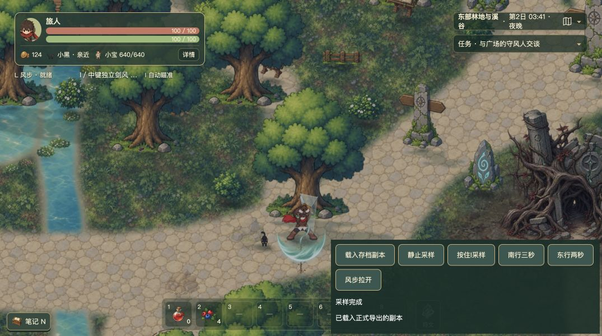

# 攻击预警、风步与持续剑风掉帧修复

日期：2026年10月4日。状态：正式源码已修复，专项与固定构建对照通过；保留既有工作树修改，未提交、推送或部署。

后续勘误：上述结论当时仅覆盖源码及独立固定构建，用户5309页面仍在运行旧包，交付遗漏已在同日复核中补齐。最新无I键样本进一步确认小宝环境在战斗子步重复预测的开销放大，并发现尚未修复的地形同步烘焙短抖动。实际页面更新、存档回读与剩余问题见[持续掉帧根因复核](../combat-stall-20261004/report.md)，不能据本报告宣称全部掉帧已经解决。

## 修复结果

共享障碍查询从每次扫描全地图改为先筛选附近实体，再执行原精确判定。普通近战预测先排除剩余位移与攻击几何绝不可能触及的目标，避免风步拉开后继续完整推演无效接触。

同一份正式导出存档、同一路线的本机Chrome固定构建对照：修复前103.1帧／秒，修复后120.0帧／秒，修复前复测106.1帧／秒。预警与战斗推进耗时显著降低，剑风表现耗时基本一致。此结论支持此前定位的共享碰撞扫描是该场景的主要瓶颈；不保证其他构筑、设备与长期混战全部稳定120帧。

## 正式修改

- [共享物件筛选](../../../src/data/world.ts)：128世界单位网格，按地图几何修订和列表长度更新索引；点、运动线、近战线和剑风共用。候选保持原物件顺序。运动按脚底半宽12、半高10扩张，剑风按自身半径扩张。查询容差覆盖原线段裁剪的参数容差，跨格擦边不会被提前漏掉。超过64格、非有限或非安全格坐标回退全扫描。
- [障碍线查询](../../../src/game/systems/obstacles.ts)：默认查询使用空间筛选，调用方显式提供的物件数组继续原样使用；地形、水域、桥梁和高处射击逻辑保留。
- [剑风障碍查询](../../../src/game/systems/swordWindGeometry.ts)：仅筛选默认实体候选，沿用原碰撞距离、世界边界、训练靶豁免及相同距离时的身份排序。
- [近战预测](../../../src/game/systems/enemyAttack.ts)：上界为剩余最大位移加攻击几何包围距离，考虑锁向向量长度及未锁向时的新瞄准。范围内继续原逐毫秒扫描；首领、特殊几何、远程与爆点继续各自原路径。

不更改伤害、攻击范围、预警外观、5毫秒模拟步长、弹反时间窗口、存档结构或怪物上限。索引只保存在运行内存，门、捷径、岩柱和传承封锁改变时沿用已有 `mapGeometryRevision` 失效机制。

## 固定构建对照

本轮开始时冻结上述四个源文件，先完成原始生产构建，再完成修复后生产构建。两份构建保存在被忽略的 `.combat-performance-local/`，没有恢复或覆盖用户源码。校验值见[源码与存档校验](source-hashes.json)。

运行测量使用相同Vite生产流水线、相同计时包装的两份独立构建，端口5312和5313；计时控件只在诊断入口加载，没有接入正式启动流程。测量期间没有运行测试或构建任务。

样本来自正式导出的第19份存档副本，通过正常游戏输入链路：向南行走3秒，向北风步拉开，再按住I采样8秒。控件模拟按键，不授予技能、不修改怪物或伤害、不覆盖5173与5309的用户存档。另以原生I单按确认剑风动作；原生持续按住组合与用户具体配置仍未完整验收。

| 指标 | 修复前 | 修复后 | 修复前复测 |
| --- | ---: | ---: | ---: |
| 平均帧率 | 103.13 | 119.99 | 106.13 |
| 样本帧数 | 825 | 960 | 849 |
| 帧间隔九五分位（毫秒） | 16.70 | 9.30 | 16.70 |
| 帧间隔九九分位（毫秒） | 25.00 | 9.40 | 25.00 |
| 最长帧间隔（毫秒） | 33.40 | 9.50 | 32.70 |
| 超过16.67毫秒帧数 | 71 | 0 | 56 |
| 超过33.34毫秒帧数 | 1 | 0 | 0 |
| 战斗推进九五分位（毫秒） | 10.30 | 1.10 | 9.40 |
| 预警九五分位（毫秒） | 2.40 | 0.20 | 2.30 |
| 剑风表现九五分位（毫秒） | 0.10 | 0.10 | 0.10 |
| 渲染提交九五分位（毫秒） | 1.20 | 1.30 | 1.20 |
| 攻击与剑风共存帧数 | 28 | 56 | 28 |
| 结束生命值 | 20.8 | 20.8 | 20.8 |
| 失焦或后台帧数 | 0 | 0 | 0 |

各起点最大偏差约1.23世界单位。未冻结随机数与帧时刻，因此不是严格逐帧录制回放。受击会依照正式规则清理持续剑风，共存帧数量有限。计时中的渲染耗时是CPU提交时间，没有直接GPU硬件计时。

[对照摘要](runtime-comparison.json)、[修复前原始记录](baseline-runtime.json)、[修复后原始记录](fixed-runtime.json)、[本地固定构建复核脚本](build-runtime-check.mjs)。脚本依赖本机冻结源码与导出的存档，离开当前工作区不能直接重建本次原始基线。

## 逻辑验证

新增[碰撞与接触预测回归](../../../tests/combat-spatial.test.ts)，加入项目默认测试命令，8项通过：

- 项目实际物件周围2500组查询，每组包含点、运动线、近战线与不同宽度剑风，共10000次对照，与显式全地图扫描一致。
- 动态村门、全部捷径、岩柱及传承封锁解除／恢复后即时查询，与全扫描一致。
- 跨格的脚底与剑风宽度、起点擦边、终点参数容差、候选顺序、显式空数组、追加及移除物件均覆盖。
- 大跨度、非有限与非安全格坐标回退，避免无界格子遍历。
- 八种近战行为、三种精英步长、七种距离、三种方向、两种锁向，共1008例；包含中途已移动与受击延迟，与完整扫描接触时间一致，原攻击对象不被修改。
- 32例未锁向瞄准及非单位方向边界；首领特殊几何维持原扫描。

最终战斗专项：空间筛选、攻击预警、障碍、剑风、狼爪、首领六文件共150项通过。城市、连续商路、地图扩展、传承、首领精度与效果补充六文件：102项通过、1项既有失败。类型检查和正式生产构建通过；构建仍有既有大文件提示。

最终源码执行 `npm test`：74个文件，1456项通过、1项既有失败，耗时92.48秒。全量未达到全绿，不能据此宣布整体发布通过。最终源码的150项战斗专项、8项新增回归与正式构建均通过。

已核对的既有失败，均通过冻结修复前四模块复现相同首因，未改测试来掩盖：

1. `tests/village-raids.test.ts:63` 仍断言地图版本8，当前地图版本9。修复前后均收到9。
2. `tests/wind-legacy.test.ts:24` 将当前十槽符文数据标记为旧五槽版本，触发 `runeState.ts:72` 的历史形状校验。该文件不在默认 `npm test` 清单中，本轮额外检查发现；修复前后均报“旧符文配装存档无效”。

## 对抗式代码审查

VERDICT: PASS

审查对象：本轮正式源码增量、共享调用链及新增测试。审查结论仅针对本轮修复，不代表整个脏工作树或发布版本通过全部验收。

P0/P1 BLOCKERS:

无成立的P0/P1阻塞问题。已进行反证检查：

- 动态障碍过期：当前运行源码的实体形状变化统一在 `syncMapGeometry` 增加修订号，索引查询前核对；开关专项即时对照通过。对象初始摆放与形状调整都在模块初始化期完成。
- 漏碰撞或撞错对象：运动占地、剑风半径、跨格与原裁剪容差均纳入筛选；索引保留原物件序，自定义数组不替换，精确判定继续原路径。训练靶和世界边界逻辑未动。
- 漏预警或错接触：排除仅用于普通近战，上界覆盖剩余位移、几何尖端与半径；未锁向先用原瞄准规则，首领及特殊攻击保留原路径。范围边缘、方向长度、已移动与延迟样本和完整扫描一致。
- 无界运行与资源增长：查询限制格数与安全坐标，大跨度回退；当前项目实体均为有限地图数据。索引重建先清空，未建立逐帧增长的持久缓存。
- 数据与生命周期：未更改存档、伤害结算、敌人数量或模拟时钟；性能测试使用独立来源与存档副本。

UNVERIFIED RISKS:

- 用户原始怪物、符文与风赐组合尚未完全匹配，原生持续按住I和长期战斗、其他设备性能未完成验收。
- 完整新档到通关、所有门和石障组合的原生操作及刷新读档未在本轮穷尽；逻辑专项和存档副本导入不能替代完整流程。
- 当前工作树的两项既有旧数据测试失败影响整体测试绿灯，本轮未修复其夹具，不据此宣布全项目通过。

NON-BLOCKING FINDINGS:

- 两项旧迁移测试应在独立维护中对齐当前地图与真实历史符文形状；既有失败不构成本轮碰撞修复的回归证据。
- 本轮性能目标已达到该样本的屏幕刷新上限，未追加预警几何缓存或剑风特效降级。仅在后续计时仍指向这些开销时继续优化。
