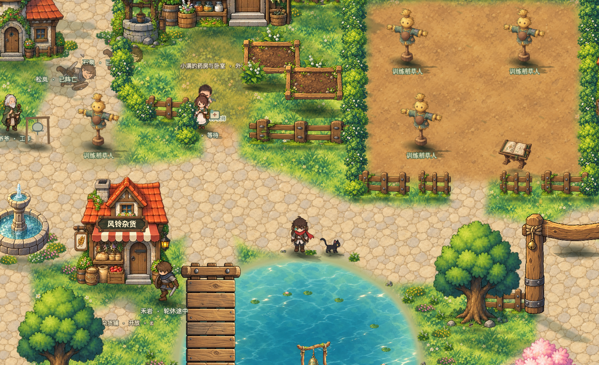

# 游戏帧率瓶颈定位与修复

日期：2026年10月3日。已找到并修复本次村庄场景的主要瓶颈：阴影管理用的完全透明椭圆仍提交三角形，反复打断贴图合批。在同一冻结版本、同一存档副本、同一前台页面中，两轮交替对照均从约48—50帧提高到120帧。修复不降低分辨率，不移除可见阴影。

## 根因与修改

产品代码只改动 `src/game/rendering/groundShadows.ts:42`：把 `contact.setFillStyle(0x122019,0)` 改为 `contact.setFillStyle()`。

具体调用链：

1. `GroundShadows.add` 已用柔边贴图与轮廓网格取代原椭圆的视觉表现，但之前仅把椭圆填充透明度设为0。
2. 当前安装的 Phaser 4.2.1 中，`Shape.setFillStyle` 只要收到颜色参数，就令 `isFilled=true`；透明度为0也不例外。
3. `EllipseWebGLRenderer` 见到 `isFilled=true` 后调用 `FillPathWebGL`。后者仍把顶点送入 `BatchHandlerTriFlat`，没有按零透明度提前退出。
4. `BatchHandlerTriFlat.batch` 调用 `RenderNodeManager.setCurrentBatchNode`；后者在节点变化时立即执行上一批次。因此穿插在图像之间的透明椭圆会把贴图批次反复拆开。
5. 禁用填充后，不再进入三角形批次。椭圆对象本身继续提供位置、尺寸、显隐、透明度和飞行缩放；可见的柔边贴图、轮廓投影及原有销毁机制照常工作。

本地依赖证据位于 `node_modules/phaser/src/gameobjects/shape/Shape.js`、`shape/ellipse/EllipseWebGLRenderer.js`、`shape/FillPathWebGL.js`、`renderer/webgl/renderNodes/BatchHandlerTriFlat.js` 和 `RenderNodeManager.js:395`。

## 同条件交替验证

使用用户导出的存档副本，经正式导入流程载入独立的5261端口。设备为 Apple M5 Pro，Chrome 154，Metal硬件渲染；视口1075×656，设备像素比2，游戏画布1613×984。所有四组均无后台帧、无失焦帧。每组预热1.5秒、采样12秒，平均帧率按总帧数除以原始帧间隔总和计算。

| 顺序 | 阴影占位处理 | 平均帧率 | 帧间隔95分位 | 平均绘制调用/帧 |
| --- | --- | ---: | ---: | ---: |
| 原实现 | 填充透明度为0 | 47.87 | 26.0毫秒 | 221.92 |
| 修复 | 禁用填充 | 120.01 | 10.0毫秒 | 32.20 |
| 恢复原实现 | 填充透明度为0 | 49.97 | 25.7毫秒 | 223.41 |
| 再次修复 | 禁用填充 | 120.00 | 10.1毫秒 | 32.23 |

绘制调用下降约86%，帧率约为原来的2.4倍。原始数据见 [交替实验](source-fix-abab.json)。这是针对实际阴影对象调用同一填充API的对照，并非通过删除全部图形估算修复收益。

随后把正式修复文件复制到冻结源码目录，重新启动页面、重新导入同一存档副本，采样20秒连续往返移动：

- 2400帧，平均119.99帧，帧间隔95分位10.2毫秒，最长10.4毫秒。
- 每帧平均32.56次绘制调用，整个引擎同步回调平均3.89毫秒。
- 玩家横坐标实际覆盖1175.43—1394.68，范围219.24；生命维持100，世界时间正常推进。
- 由诊断按钮持续派发左右输入事件，走正常移动与碰撞逻辑，不修改玩家坐标；这是自动输入场景，不能替代人工手感验收。
- 所有帧均在前台且有焦点，未记录长动画帧，采样结束后读取页面错误日志为空。

证据见 [修改后移动采样](candidate-movement.json)、[修改文件校验](candidate-source.json)。

## 画面一致性

在同一暂停世界、同一相机中，仅切换阴影占位填充，分别于渲染完成后读取游戏画布，逐个比较RGBA像素：1613×984，共1,587,192个像素，差异像素为0，最大通道差为0。

可见柔边阴影与投影保留。该对比覆盖游戏画布；独立DOM光照层与界面不在画布像素比较范围内，修复也未修改这些层。原始结果见 [像素比较](visual-equality.json)，图片为 [修复前](shadow-before.png) 与 [修复后](shadow-after.png)。

## 如何排除其他原因

- 停止世界逻辑后仍约54帧；停止世界与光照绘制后约119帧，方向收敛到渲染路径。
- 单独停止光照、冻结界面、关闭可见动态投影均仍约53—54帧，未解除主要瓶颈。
- 按图形类型隔离后，跳过形状达到约119帧、绘制调用降至约33；跳过文字、网格或矢量图形没有同级收益。
- 进一步只跳过完全透明形状，恢复到约119帧；恢复原行为后又回到约49帧。随后沿源码定位到阴影占位填充，并完成上面的真实API交替验证。
- 原生线程采样观察到浏览器图形进程大量等待Metal命令完成，与上述现象相符。但图形进程为多标签共享，不能单独据此归因，也不能把线程采样比例当作GPU硬件耗时。

过程数据见 [第一组隔离](isolation-one.json)、[第二组隔离](isolation-two.json)、[绘制类型隔离](isolation-types.json)、[透明形状隔离](isolation-transparent.json)、[原生线程采样摘要](native-profile-summary.json)。本机不支持GPU计时查询扩展；没有把同步提交时间、帧间隔差额或 `gl.finish()` 测量包装为真实GPU耗时。

## 版本与验证边界

- 诊断期间有其他会话并行修改地图、战斗和资源。为避免热更新污染实验，把当时218个源码文件冻结到 `/tmp/farwind-bottleneck-root-20261003`；清单见 [冻结源码校验](frozen-source.json)。交替实验使用同一已加载页面，最后移动复验仅替换阴影模块。依赖与公开素材沿用本机目录。
- 前一轮约26帧来自新档、不同窗口高度和当时工作树，不能与这次120帧直接构成同条件增幅。可信对照为本报告的48—50帧与120帧交替实验。
- 本次证明的是该存档村庄视野中的主要瓶颈与修复收益。没有将结果外推为密集战斗、首领、夜袭、长时运行或并行新增城市的全场景120帧保证。
- 原5173站点存档没有被诊断导入覆盖。改动未提交或推送。

已通过阴影专项测试（`tests/shadows.test.ts`，4项）、类型检查与构建。构建输出位于临时目录，存在已有的大分包提示；未进行全项目功能回归。

## 改动审查

VERDICT: PASS

P0/P1 BLOCKERS：无。

已沿阴影创建、可见性、尺寸/透明度读取、轮廓投影、场景关闭和实体销毁路径复核。此次调用只改变填充开关，不改变阴影锚点状态或保存、战斗、碰撞数据；现有可见阴影与销毁保护仍在。经源码反证与实际对照，未发现该修改产生的成立P0/P1问题。

UNVERIFIED RISKS：密集战斗、长时运行与并行新增城市的性能未完整验收；不影响本次局部修复结论。

NON-BLOCKING FINDINGS：视野外贴图仍有额外裁剪空间，单独隔离可获得收益；本次修复已达到当前页面约120帧，无需把额外裁剪、界面节流或逻辑降频混入修复。

## 复核方式

诊断入口为 `bottleneck-server.mjs` 与 `bottleneck-probe.js`，只在独立开发服务中插入按钮和计时，不进入正式构建。服务读取本机下载目录中的 `farwind-save (18).json`；迁移到其他机器时需调整该路径。

在本次冻结副本上复核旧/新交替时，先仅在副本恢复原来的 `contact.setFillStyle(0x122019,0)`，通过 `FARWIND_PERF_ROOT=/tmp/farwind-bottleneck-root-20261003 node docs/performance/frame-rate-20261003/bottleneck-server.mjs` 启动，打开5261页面，依次点击“载入诊断存档副本”和“开始源头修复对照”。像素按钮也以加载时的填充状态为原状态；若直接在已修复源码上运行，只能验证修复后状态，不能误称旧/新对照。

最后把正式修复文件复制回冻结副本，重启、重新载入存档并点击移动采样。新运行会覆盖 `bottleneck-latest.json`，固定实验文件不自动覆盖。
