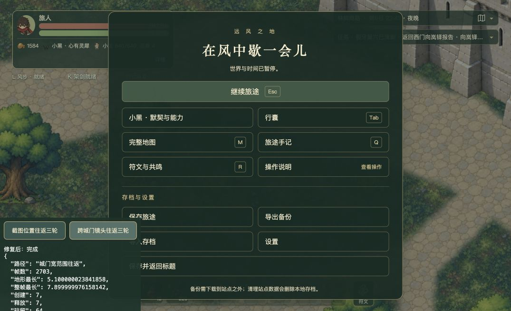

# 城门外往返掉帧修复与验收

2026年10月5日，源码基线 `69bea77b`，工作区修复未提交、未推送。用户原页面为 `http://127.0.0.1:5173/`，生产构建为 `assets/game-Cb0B1VMo.js`。完整采样摘要、最慢帧、像素和存档核对见 [comparison.json](comparison.json)。

## 根因与修改

城门外约（8745，1788）反复横向移动时，相机跨越地形块选择边界。旧实现离开视野加一圈的范围就销毁纹理，折返重新同步烘焙600×550块；三轮均新增10块。门前进一步拉远镜头又扩大地形需求。这里没有新增任务或遭遇触发。

保留最多64块近期地形，按最近使用淘汰远块；超长视窗按实际覆盖量扩容，优先避免缺地面。提前两圈排队，每帧约2毫秒推进遮罩、合成和装饰绘制。仅把CPU循环分帧仍会在上传时集中光栅化，因此每段合成后读取一个像素，先完成该段光栅化，再让出执行。

同一时刻仅一个在建块，共用遮罩；所有暂停点都在画布保存与恢复成对操作之外。离开排队范围、清剿状态改变及场景关闭均清理在建纹理。清剿、风忆、读档只使受影响地面失效。角色、道路、碰撞、任务、奖励和存档结构没有修改。

## 实际浏览器对照

通过Chrome可见诊断按钮，从第24份用户存档副本正式导入，在固定生产构建中发送正常键盘事件。短程每段1100毫秒，宽程每段3300毫秒，均左右往返三轮；没有直接改角色位置或授予属性。两组最终对照视口均1075×656、设备像素比2。采样全部保持焦点，无暂停帧。短程覆盖约8485至8746，宽程约8745至9521，后者包含城门镜头拉远。

| 路线 | 修复前最慢整帧 | 修复后最慢整帧 | 修复前最慢地形 | 修复后最慢地形 | 三轮新增块：前→后 |
| --- | --- | --- | --- | --- | --- |
| 截图位置短程 | 32.4毫秒 | 8.3毫秒 | 28.7毫秒 | 5.1毫秒 | 10/10/10 → 7/0/0 |
| 城门镜头宽程 | 31.3毫秒 | 7.9毫秒 | 28.8毫秒 | 5.1毫秒 | 10/10/10 → 7/0/0 |

短程采样1076／1118帧，宽程2661／2703帧。修复后两条路线均没有新增可见缺块的紧急同步生成。原始逐帧记录和诊断构建保存在本地忽略目录 `.combat-performance-local/gate-check/`，按 `before-short`、`after-short`、`before-wide`、`after-wide` 区分；这不是逐帧同随机数回放，不由采样推导全游戏帧率。

## 图形、状态与容量

- 短程结束位置修复前的25个地形块，与修复后对应块逐像素缓冲哈希全部一致；不把接触阴影纹理计入地形块数。
- 独立固定样本核对南方巢口：未清剿与已清剿哈希不同；风忆重新开战恢复未清剿材质；退出恢复清剿材质；再读未清剿存档恢复原材质。该流程只验证材质失效，不计为真实清剿或通关。
- 正式导入10个不同位置样本，驻留和地形纹理数量均不超过64。场景关闭和中断任务清理已检查源码；未做长期堆内存曲线验收。
- `npm run build` 通过，包含类型检查；地形缓存、过渡、首图、原野地图、接触轮廓、城墙美术、小地图与巢穴8个专项文件共40项通过。既有大型构建包提示仍存在；没有宣称全量回归通过。

## 原5173页面交付

已核对实际Vite响应包含新的地形调度与缓存，继续原旅途、保存并导出第25份备份，刷新后继续并导出第26份回读备份。与第24份相比，三份的玩家位置、生命111、体力112、金币1584、背包、快捷栏、任务、商路巢穴、遭遇、风赐和版本字段一致。符文／小宝模拟时钟、居民／守卫活动、生活状态和世界时间随恢复运行自然推进，并非整份存档逐字相同。第24份原备份保留，测试固定样本没有导入原5173页面；交付后页面保持暂停。

## 审查

VERDICT: PASS

P0/P1 BLOCKERS: 无。

已对抗检查：缓存保护和淘汰、单任务共用画布、取消时保存恢复平衡、半成品纹理生命周期、清剿与风忆失效、读档和室内外切换、地面排序、异常视窗覆盖、唯一装饰烘焙调用点及存档边界。候选严重问题经现有保护与可达路径反证后，没有成立的P0/P1。

UNVERIFIED RISKS:

- 全地图连续长跑、风步最快路径、低端设备及长期内存曲线尚未验收。
- 首次加载、读档／传送及可见清剿块失效仍同步补齐地面，可能产生冷启动长帧；本轮解决普通移动和往返的重复烘焙。

NON-BLOCKING FINDINGS:

- 64块缓存比旧版约25块增加内存，以有界驻留换取折返复用。
- 2毫秒是调度目标，单次浏览器绘制、创建或上传不可被抢占；实测地形最慢5.1毫秒，不宣称严格2毫秒上限。
